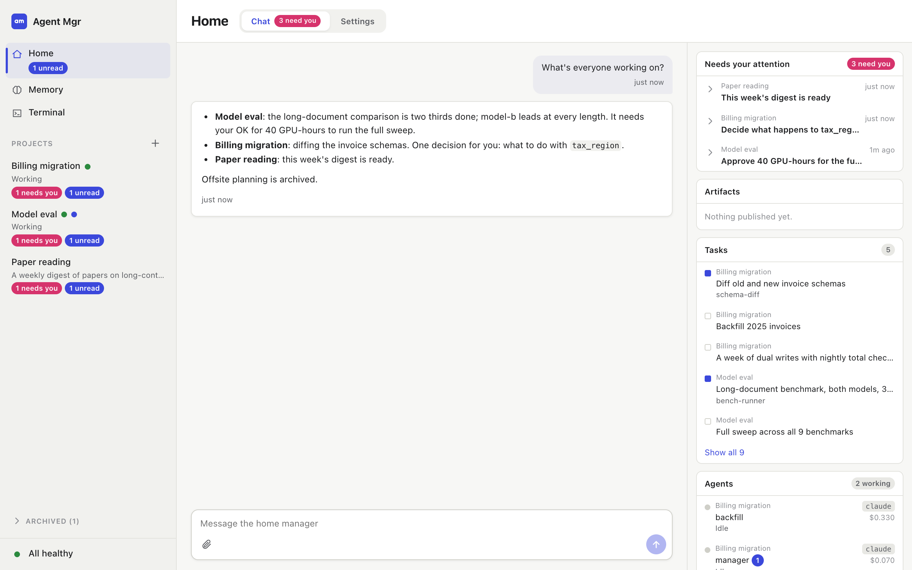
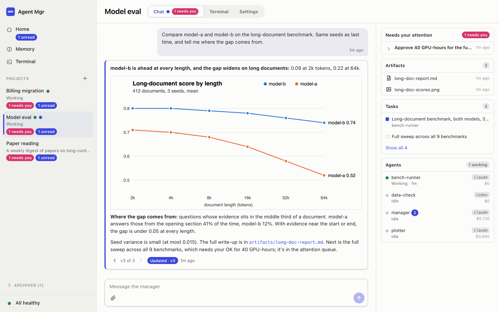
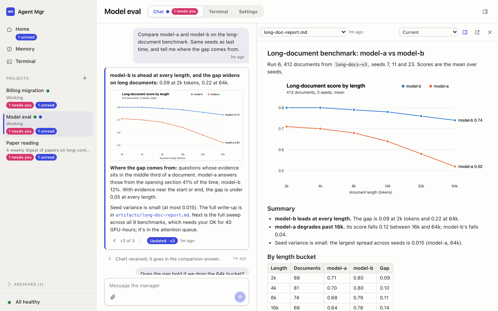
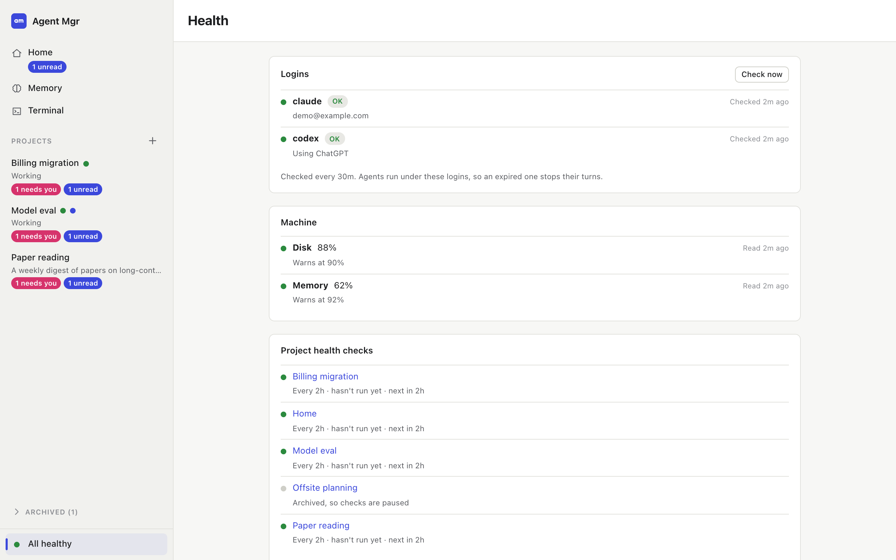
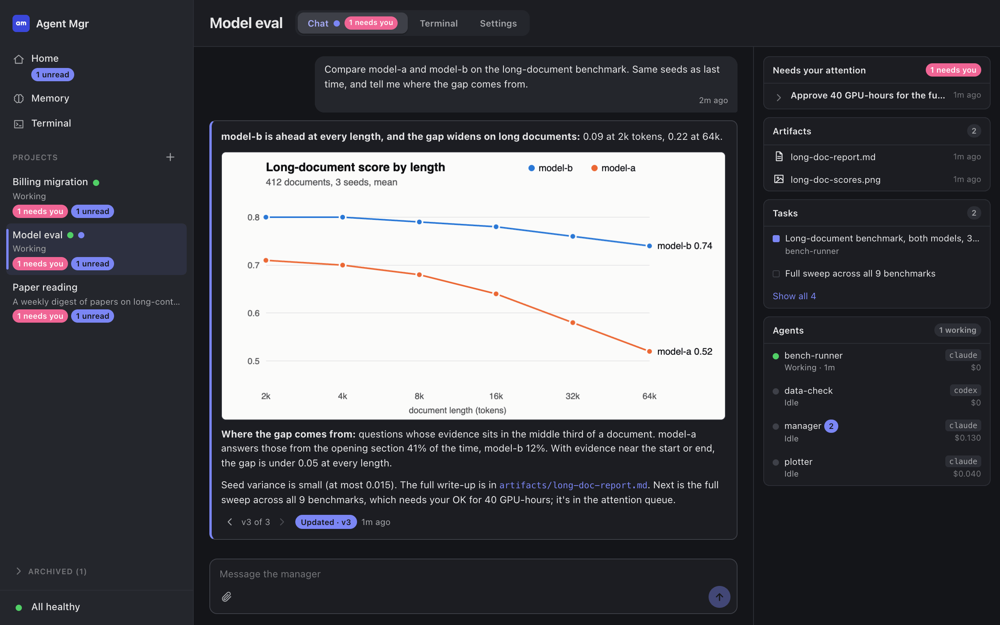
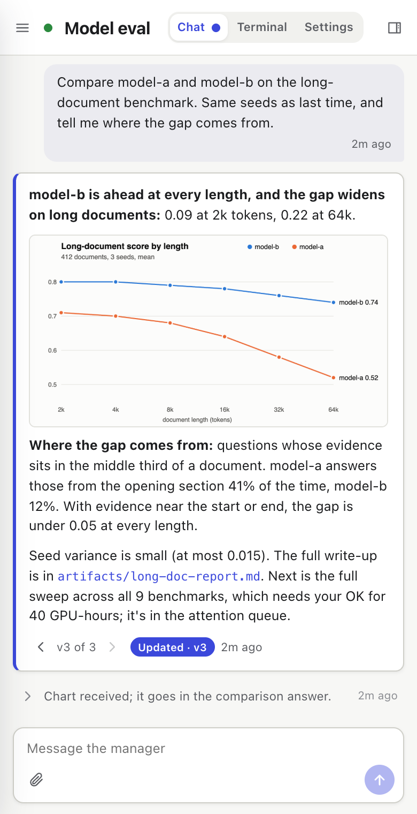

# Agent Mgr

Agent Mgr runs a hierarchy of agents. You talk to a home manager, the home manager creates projects, and each project has a manager that delegates work to workers. Each agent is a `claude` or `codex` CLI session. A daemon runs the sessions, delivers messages between them, and serves a web UI.

Agent Mgr is a single Rust binary, `am`: the CLI, the daemon and the turn supervisors.

## Screenshots

The projects, agents and data in these are mock ones.

**Home.** Every project, what needs you, the tasks and agents across projects, and the health dot.



**A project's chat.** The manager updated its answer to v3 when the results came in, with a chart inline.



**Artifacts.** A report opens in a panel docked beside the chat.



**Health.** Logins, disk and memory, and each project's health check.



<details>
<summary>Dark mode and phone</summary>





</details>

## Getting started

You need [Rust](https://rustup.rs) (the workspace pins 1.90 in `rust-toolchain.toml`, which rustup installs on first build), git, and at least one of `claude` and `codex`, logged in. Terminals in the UI need `tmux`, and storage offload needs `rclone`.

```sh
cargo build --release
ln -sf "$PWD/target/release/am" ~/.local/bin/am   # or anywhere on your PATH
am setup          # creates ~/agents with config.toml and the home project; safe to re-run
am daemon start   # the web UI, runner, scheduler and health checks
am url            # prints the web UI address, including its access token
```

`cargo install --path crates/am` works too, and puts `am` in `~/.cargo/bin`.

Open that address and tell the home manager what you're working on. Set `AM_HOME` to keep everything somewhere other than `~/agents`.

`am setup` and the daemon write `$AM_HOME/bin/am`, a shim that execs the binary they ran as, and turns put it first on agents' `PATH`. After rebuilding, run `am daemon restart` to run the new daemon; it rewrites the shim too, in case the binary moved.

### Where the prompts and the UI live

The binary reads the web UI and the prompt templates from disk at runtime, so editing them needs no rebuild:

- `assets/webui/`: the web UI, plain ES modules and CSS with vendored libraries in `vendor/` (their licenses are in `vendor/LICENSES.txt`). There's no build step.
- `assets/prompts/`: everything Agent Mgr says to an agent, as templates. `assets/prompts/README.md` explains the layout.

The path to `assets/` is baked in at build time from this checkout (`am_core::assets`), so keep the checkout where it was built. Set `AM_ASSETS` to a directory holding `webui/` and `prompts/` to read them from somewhere else.

## Permissions

Turns run unattended, so nobody can answer a permission prompt, and what agents may do is decided up front in `config.toml`:

| Backend | Default | What it means |
|---|---|---|
| `claude` | `permission_mode = "auto"` | Claude Code's safety checks review each action. `Bash(am *)` is always allowed. |
| `codex` | `sandbox = "workspace-write"` | Turns can write only inside the project and `AM_HOME`. `network = true` allows network access. |

An agent that hits a limit says what it needs: managers put it in your attention queue, and workers put it in their report. `bypassPermissions` (claude) and `danger-full-access` (codex) remove these limits entirely, so only use them on a machine you're happy for agents to do anything on.

The web UI listens on `127.0.0.1` by default, and answers only to a private hostname under `.localhost`, which is what `am url` prints. Cookies don't isolate ports, so this is what keeps your session cookie from other servers on this machine. The access token in `am url` grants full control of your agents, so treat it like a password. Changing `[web] host` exposes the UI to your network over plain HTTP.

## How it works

**Turns.** An agent works in turns, each fed the agent's pending messages. A claude agent keeps one `claude -p --input-format stream-json` process between turns and writes each turn to its stdin, so a turn skips the CLI's start and the instructions are sent once per process. The process stops after 55 minutes with no turn, to match the prompt cache's hour. At most six stay up at once, about 300 MB each, and the least recently used idle one goes first. A change to the agent's model, backend or instructions starts a new one. A change to shared memory doesn't: the next turn is told what changed, and the next process gets the new index. A codex agent runs `codex exec resume <thread>` for each turn. `[runner] persistent = false` makes claude do the same with `claude -p --resume <session>`.

**Side turns.** While a worker's main turn runs, a new message from you or another agent starts a side turn on a fork of its session (`--fork-session` or `codex exec fork`). The fork answers right away, and the exchange is passed back to the main session.

**Managers.** Managers keep their turns short, delegate real work, and get no side turns, so a message to a busy manager is shown as *queued* until the current turn ends. To deliver it now, use **Interrupt and send**, or `am send --interrupt`: the main turn stops, and a new one resumes the same session with your message first in line.

**Answers.** A manager talks to you only to answer you. The final reply of a turn with your message in it becomes an answer card. When later work changes the answer, the manager publishes a new version, written from scratch, with `am answer`. The card stays where it is. Until you've seen the new version, its card is highlighted with an "Updated · v3" pill, a marker row at the bottom of the chat jumps to it, and a dot appears on the chat tab and in the sidebar. `<` and `>` step through the history.

**Activity.** Turns without a message from you, such as worker reports and checks, leave only a one-line row, and two or more fold into "N background events". Anything that needs you goes in the attention queue.

**Replies.** Every chat item has a stable id: a message `m-...`, an answer version `m-...@v2`, and a note `t-...`. Hover over an item or tab to it, then reply. The agent gets an excerpt, plus `am show <id>` for the full text.

**Archiving.** Archive a project from Settings, or with `am project archive <slug>`, to set it aside. It moves to a collapsed Archived section at the bottom of the sidebar, and can still be opened and read. Nothing is deleted, and it's undone with **Un-archive** in that section or in Settings, or with `am project unarchive <slug>`. While it's archived, its schedules and health checks stop and no new turns start, though a turn already running finishes normally. Messages to it are held and delivered on un-archiving, and `am send` says so. Its attention items, tasks and agents leave the home page, and return on un-archiving. Un-archiving fires nothing by itself: runs missed while archived are skipped, an interval schedule counts from the moment it's un-archived, and a cron schedule waits for its next time. The home project can't be archived.

**Artifacts.** Results for people go in a project's `artifacts/`, published with `am artifact publish` and named by path in answers. A path or link to one opens it in the side panel. Select a passage of a document or HTML artifact to send the manager a comment about it. Every version is kept in `projects/.artifacts.git`.

**Artifact security.** HTML that agents write may run scripts, so artifacts are served from capability URLs, `/a/<token>/<slug>/{artifacts,results}/<path>`, under a CSP `sandbox` without `allow-same-origin`. They get an opaque origin, with no cookies and no access to the UI or its storage. `connect-src` and `form-action` are `'none'`, so they can't fetch or post, and everything they load must come from the project or be inline. A page can still navigate itself or open a window, which CSP can't prevent, so a hostile page could send what it can see to another site that way. Tokens are HMACs of the project and an expiry 12 to 13 hours out, keyed from the web token, and they grant only GETs of that project's artifacts and results.

## Reliability

Turns are detached processes that record everything in their turn directory, so restarting the daemon doesn't interrupt them, and the new daemon adopts them. A long-lived claude process is owned the same way, by a detached supervisor (`am __proc`) that hands it turns from its `queue/` and copies its output into each turn's directory, so it survives a daemon restart too. An interrupt is a control message to that process: the turn stops at once, and the process stays up for the next one, unless the turn left background tasks running, which stop with it as they would with a one-shot turn. A process that crashes, or a turn that fails, ends the process, and the retry resumes the session in a new one. A turn whose process vanished, as after a machine restart, is retried with a note telling the agent to check what it started. Other failures retry with backoff and then raise an attention item.

A turn survives the machine sleeping, but it doesn't make progress, so keep a machine that's doing long work awake (`caffeinate -is` on a Mac, or a power setting).

Disk and memory alerts go to the home manager, which follows the storage policy in `assets/prompts/roles/home.md`. Logins are checked periodically, and an expired one becomes an attention item with a **Run** button that runs the fix in a terminal in the UI.

## Health

A dot at the bottom of the sidebar shows how things are: green when all is well, amber for a warning or something that couldn't be determined, and red when a login has expired or a tool is missing. On a phone, the dot is in the page header, and its label is in the menu. It opens the Health page, which `am health` prints too:

- **Logins.** The state of each login, from the checks in `[logins]` and the `claude`, `codex` and storage logins: OK, Expired, Not installed, or Unknown when a check timed out or couldn't reach its service, which is never reported as expired. **Fix** runs the login's fix command in a terminal and rechecks it when the terminal closes. **Check now** rechecks everything. A turn refused for auth marks its backend's login Expired straight away, even if the status check still says it's fine, because the status check doesn't try the login the way a turn does. That lasts until the agent's next turn works, the item is resolved, or a Fix is confirmed by the check, which also resumes the agents that were waiting.
- **Machine.** Disk and memory against their warning thresholds.
- **Project health checks.** How often each runs, when it last ran, when it's next due, and its one-line reply. The reply is free text, so a problem the manager found shows only there and in the attention queue. The row turns amber if the check's own turn failed or the manager looks stuck.

The latest results are kept in `daemon/health-state.json`, so all this is right straight after a restart. Fix sends only a login's name, and the server runs the command it holds for that login, and only while that login needs it. Check output isn't stored or logged, because it can hold account details: the page shows a short detail picked out of it, such as the account's email.

## Files

All state is in plain files under `~/agents`:

```
config.toml
daemon/health-state.json   the latest login and machine readings
memory/                    one markdown file per entry, recorded in .memory.git
projects/
  .artifacts.git           version history of every project's artifacts
  <slug>/
    project.json           description, status line, default backends, health check frequency, when archived
    log.md                 the manager's private log
    tasks.json             the Tasks card
    schedules.json         the schedules in Settings
    attention/<id>.json    what needs you
    workspace/ results/ cache/ artifacts/ attachments/
    agents/<name>/
      agent.json           role, backend, model, session, cost
      inbox/<id>.json      pending messages
      delivered/<id>.json  messages a turn has taken
      answers/<question>/v<N>.json
      notes/<turn>.json    activity rows
      turns/<turn>/        prompt, stream, stderr, exit status and result of one turn
      procs/<proc>/        a long-lived claude process: its command, output and turn queue
```

Agents coordinate through the `am` CLI, which works directly on these files, whether or not the daemon is running. Every write is an atomic rename, read-modify-write goes through `flock` lock files, and a mailbox is a directory with one file per message, so sending needs no lock. Each message's sender and kind are set by `am`. All agents run as you and share these files, so this keeps honest agents straight rather than being a security boundary between them.

## The `am` command

Run `am <command> --help` for the details.

| Command | |
|---|---|
| `am setup` | Create `~/agents`. Safe to re-run. |
| `am daemon start\|stop\|restart\|status` | Control the daemon. Stopping it doesn't stop running turns. |
| `am url` | Print the web UI address, including its access token. |
| `am health [--check] [--json]` | The state of logins, the machine and each project's health check. `--check` runs the login and machine checks first. |
| `am send [--interrupt] <agent> <text>` | Message `worker`, `project/agent`, or `project` (its manager). |
| `am stop <agent>` | Stop an agent's main turn. |
| `am answer <m-id> <text>` | Publish a new version of an answer. |
| `am questions` | List your questions and their latest answers. |
| `am show <id>` | Print an item in full: `m-...`, `m-...@v2`, `t-...` or `a-...`. |
| `am project create\|list\|show\|set` | Create and configure projects. |
| `am project archive\|unarchive <slug>` | Pause a project without deleting anything, and resume it. |
| `am project offload\|restore <slug>` | Back up a whole archived project to shared storage, leaving a stub, and bring it back. |
| `am agent create\|list\|set\|retire\|show` | Create and configure workers. |
| `am task add\|set\|done\|list` | The project's task list. |
| `am attention add\|resolve\|list` | The attention queue. |
| `am schedule set\|list\|rm\|run` | Timed prompts to a manager or worker. |
| `am artifact publish\|link\|log\|show\|list` | Publish results and read their history. |
| `am memory add\|edit\|rm\|list\|show\|log` | Shared memory, across all projects and agents. |
| `am storage offload\|restore\|list` | Move old results to shared storage. |
| `am fix-costs` | Recompute recorded costs from each turn's own output. Safe to re-run. |

Hidden subcommands, which you don't run yourself: `am daemon __run` is the daemon process, `am __turn DIR` and `am __proc DIR` are the turn and process supervisors, and `am __debug ...` holds test hooks (`crates/am/src/debug.rs`) that do nothing unless `AM_TEST_HOOKS` is set.

## Storage offload

`am storage offload PATH` copies data to an rclone remote, verifies the copy, deletes the local data, and leaves `PATH.offloaded` behind. `am storage restore PATH` brings it back.

To use Google Drive, install rclone (`brew install rclone`) and click **Connect Google Drive** under Storage in the home project's Settings. It opens a terminal that runs `rclone config create gdrive drive scope=drive.file`, and your browser, where you sign in to Google and allow access. The `drive.file` scope lets rclone see only the files it creates. When the command succeeds, the server sets `rclone_remote = "gdrive"` under `[storage]` in `config.toml`, keeping the rest of the file and its comments, and checks the new login. The button takes only the provider's name: the command is fixed in `crates/am-ops/src/storage.rs`. For any other rclone remote, configure it with `rclone config` and set `rclone_remote` yourself.

**Offloading a whole project.** An archived project's Settings has **Offload to Google Drive**, and `am project offload SLUG` does the same. It backs up everything under `projects/<slug>/`, including agents' chats, answers and sessions, tasks, `log.md`, artifacts with their git history, `results/`, `workspace/` and `cache/`, plus each agent's CLI session files: Claude's `~/.claude/projects/*/<session>.jsonl` and the `<session>/` directory beside it, and Codex's `~/.codex/sessions/**/rollout-*-<session>.jsonl`, found from the session id in each `agent.json`. They go in one `tar.gz` with a `manifest.json`, under `project/` and `home/`, streamed to `rclone rcat` at `<folder>/projects/<slug>/<slug>-<time>.tar.gz`, so it needs no local space. A single archive keeps symlinks, modes, empty directories and git internals, which a file-by-file copy to Drive doesn't, and it verifies with one hash: the remote's MD5 must match what was sent. Only then is the local copy removed, along with those session files, leaving `project.json` marked `offloaded` with the remote path, size, time and SHA-256. The project stays under Archived with a cloud mark, and opening it offers only **Restore**. `am project restore SLUG` streams `rclone cat` into a staging directory, checks the SHA-256, then moves everything back, session files included, and the original `project.json` replaces the stub last. It stays archived; un-archiving an offloaded project restores it first and un-archives only if that worked. Both run in the background in the UI, with progress, and are safe to rerun: a failed upload leaves everything in place, an interrupted restore leaves the project offloaded, and the backup stays on the remote after a restore. The client sends only the slug, and offloading needs the project archived, with nothing still running, and a remote configured.

The Storage section also lists what has been offloaded, from `storage/manifest.json`. The Drive login is checked with the others on the Health page, and an expired one becomes an attention item. Its **Fix** and **Run** buttons run `rclone config reconnect gdrive:`.

## Development

```sh
cargo build                    # debug build
cargo test                     # unit tests
cargo clippy --all-targets
```

| Crate | What it holds |
|---|---|
| `crates/am-core` | Paths, ids, the file protocol, JSON and text formatting, clocks, config, and where assets are |
| `crates/am-store` | Projects, mail, tasks, attention, schedules, memory, artifacts, git-backed history, `am setup` |
| `crates/am-turns` | Prompts, the two backends, the turn and process supervisors, the runner, the scheduler, cost recomputation |
| `crates/am-ops` | Health checks and storage offload |
| `crates/am-server` | The daemon's lifecycle and the web server |
| `crates/am` | The `am` binary: the CLI and dispatch to the daemon and supervisors |

The on-disk formats are specified in the code and must not drift, since every home depends on them: records are written by `am_core::write_json` with `am_core::json::encode` (one-space indentation, non-ASCII kept as is, a trailing newline), and values become text through `am_core::format`. Remove keys from a record with `shift_remove`, which keeps the order of the others, rather than `Map::remove`, which reorders them (`clippy.toml` forbids it).

The tests here are unit tests. An end-to-end suite, which runs the real daemon and real processes against a stand-in agent CLI and drives the UI in a browser, is a follow-up. The hidden `am __debug` commands are its hooks.
